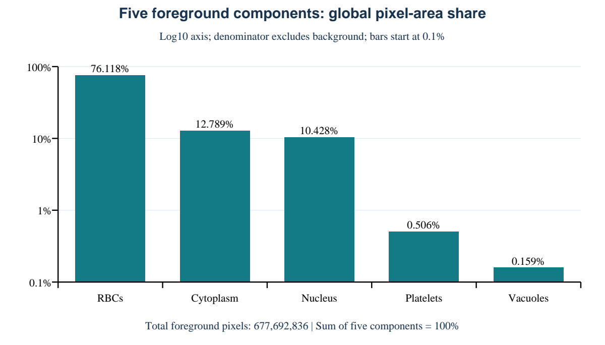

# 显微数据体检单

WBCAtt+ | 全量解码检查 | 2026-10-24T08:40:59.048040+00:00

## 结论与边界

- 文件与标注完整性：PASS；问题数 0。
- 执行位置：服务器现场执行。主机：gpu-workspace-84db4bcbf9-rvr96。
- 患者／切片独立性：无法验证。官方 CSV 未提供来源 ID，未生成严格划分。
- 官方划分重复泄漏检查：6 组完全相同图像跨集合，不能视为无泄漏划分。
- “颗粒”属于图像级形态属性，不是官方语义 Mask 类别。

## 样本与分辨率

图像 10,298 张，Mask 10,298 张；完整有效配对 10,298 对。

| 指标 | Min | Max | Mean |
|---|---:|---:|---:|
| 宽度 / px | 360 | 360 | 360.0 |
| 高度 / px | 360 | 360 | 360.0 |
| 每图像素面积 / px² | 129600 | 129600 | 129600.0 |

空间尺寸指像素矩阵尺寸；未提供显微物理标定，不能推算 μm/px 或真实面积。

尺寸分布：360 × 360 px：10298 张

白细胞图像类别（不是 Mask 类别）：Basophil 1218；Eosinophil 3117；Lymphocyte 1214；Monocyte 1420；Neutrophil 3329

## 5 类前景像素面积长尾

逐张解码原始 Mask，按标签 0..5 累加。前景分母为 677,692,836 px；全部像素分母为 1,334,620,800 px。

| 标签 | 组分 | 像素数 | 全像素占比 | 前景占比 | 出现图像数 |
|---:|---|---:|---:|---:|---:|
| 0 | 背景 | 656,927,964 | 49.2221% | - | 10298 |
| 1 | 细胞质 | 86,668,784 | 6.4939% | 12.7888% | 10298 |
| 2 | 细胞核 | 70,669,994 | 5.2951% | 10.4280% | 10298 |
| 3 | 血小板 | 3,429,022 | 0.2569% | 0.5060% | 4800 |
| 4 | 红细胞 | 515,846,377 | 38.6512% | 76.1180% | 10298 |
| 5 | 空泡 | 1,078,659 | 0.0808% | 0.1592% | 775 |

像素面积占比不是细胞实例数量占比。图中采用对数纵轴，基线为 0.1%，精确比例见表。

## 完整性检查

检查下载源文件 SHA-256、文件数量、CSV 全覆盖与官方子集一致性、重复标注、图像完整解码、Mask 完整解码、图像与 Mask 尺寸一致、Mask 为二维整数且值域仅 0..5、11 个形态属性非空。

逐样本尺寸、哈希、标签像素数：per_image_audit.csv；异常明细：integrity_issues.csv。

## 官方划分与重复风险体检（不重新划分）

官方图像级划分：train 6169；val 1030；test 3099。它不等同于患者／切片独立划分。

文件级完全重复组 14；解码 RGB 完全重复组 14，其中跨官方集合 6 组。

完全重复组中，图像级细胞类型冲突 1 组；Mask 文件哈希不一致 10 组（需人工复核，不自动改标注）。

64 位 dHash 距离 ≤ 3 的候选对 16；候选仅供人工复核，不是来源分组依据，也不能证明无泄漏。候选 CSV 未截断。

## 未实现事项及原因（非执行步骤）

本包只实现现有官方标注支持的功能，不含严格分组划分入口，也不输出来源映射模板。

1. 患者／切片级严格划分：未实现。缺少逐图真实来源映射；需补充数据提供方的脱敏患者／切片 ID 及可追溯出处。不得由文件名、类别或重复聚类猜测。
2. 颗粒像素面积：未实现。官方仅有颗粒图像级属性，没有独立颗粒像素 Mask；需补充有效的逐像素颗粒标注。缺失不记为 0。
3. 物理分辨率与真实面积：未实现。缺少显微 μm/px 标定；仅报告图像宽高和像素个数，不推算 μm/px 或 μm²。

**上述功能状态均为 NOT_IMPLEMENTED；strict_split_created=false。这不妨碍支持范围内的文件体检完成。**

## 可复现记录

- Python：3.9.19；平台：Linux-6.8.0-147-generic-x86_64-with-glibc2.39。
- 数据目录：`/home/jovyan/work/WBCAttPlus_workspace/datasets/WBCAttPlus`。
- 审计脚本 SHA-256：`056fc97f7bc1e2a6ff383441cc8f890c53e31e1baab39ae586903a11f993ac6c`。
- 数据文件校验清单：download_manifest.json；审计机器记录：audit_summary.json。
- 统计代码独立编写，不调用作者数据封装；不依赖 GPU、PyTorch 或 MMCV。

## 来源

- [WBCAtt+ official release](https://huggingface.co/datasets/apple2373/wbcattplus)
- [WBCAtt+ code and raw mask format](https://github.com/apple2373/wbcattplus)
- [WBCAtt+ paper, official image split](https://arxiv.org/html/2605.19692v1)
- [Original PBC release](https://data.mendeley.com/datasets/snkd93bnjr/1)
